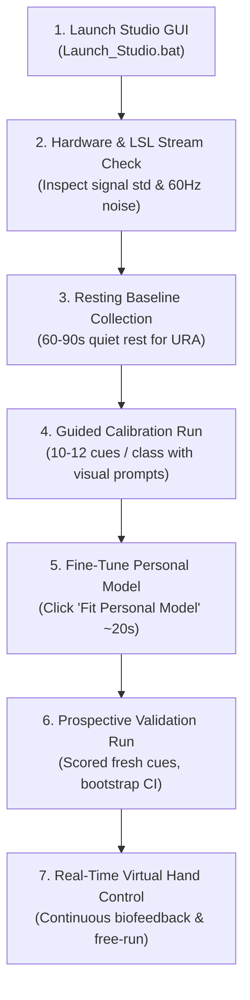

# Clinical BCI Recording, Calibration & Real-Time Validation Protocol

> Research draft for resting alignment and pretrained model experiments. Use the [X24 lab guide](README_LAB_GUIDE.md) for the current 20-channel three-class recording and validation procedure.

**Document ID**: SOP-BCI-2026-V1  
**Project**: Master Project – Non-Invasive Motor Imagery BCI with Virtual Hand Actuation  
**Author / Lab**: Giacomo / Ata Lab  
**Montages Supported**: Athena X24 (12-channel `COMMON_X24`) & EEGMI Custom (20-channel `EEGMI_CUSTOM20`)  
**Target Classes**: 
- **Binary**: Rest vs. Right-Hand Volar Grasp  
- **Three-Class**: Rest vs. Volar Grasp vs. Finger Extension  

---

## 1. Objective & Scientific Rationale

This protocol establishes a standardized operating procedure for:
1. Collecting clean, artifact-minimized EEG from a human participant.
2. Aligning participant channel covariance without labels via **Unsupervised Resting Alignment (URA)**.
3. Fine-tuning a **Multi-Subject Pretrained Temporal CNN Backbone** ([`backbone_threeclass_temporaleegnet.pt`](file:///C:/Users/giaco/Desktop/Academic%20%26%20Projects/Master%20Project/master-project-debug/decoder_and_models/backbone_threeclass_temporaleegnet.pt)) to the participant's specific sensorimotor rhythms.
4. Performing prospective, leak-free real-time validation and continuous 3D virtual hand biofeedback.

---

## 2. Pre-Flight Hardware & Subject Preparation

### 2.1 Electrode Positioning & Cap Placement
1. Measure nasion-inion and preauricular distances to accurately position **Cz** at $50\%$ vertex.
2. Ensure solid contact for primary sensorimotor channels:
   - ** Athena X24 (12 ch)**: `F3`, `Fz`, `F4`, `C3`, `Cz`, `C4`, `P3`, `Pz`, `P4`, `POz`, `O1`, `O2`.
   - **Critical Focus Channels**: `C3` (contralateral hand motor cortex), `Cz` (vertex reference/MRCP), `C4` (ipsilateral motor), `P3`, `P4` (parietal ERD).
3. Inject conductive gel; maintain electrode impedances **$\le 10\ \text{k}\Omega$** across all channels.

### 2.2 Environmental Setup
- Seat the participant comfortably in an ergonomic chair with armrests.
- Position the display monitor at eye level, approximately $70\text{--}80\text{ cm}$ in front of the participant.
- Ensure the participant's right arm and hand are comfortably resting on the armrest, completely supported with palm facing down.
- Minimize ambient electrical noise (turn off unnecessary AC adapters, fluorescent ballasts, or phone chargers in close proximity).

---

## 3. Participant Behavioral Instructions

> [!IMPORTANT]
> Non-invasive EEG motor imagery signals are microvolt-level ($10\text{--}30\ \mu\text{V}$) and are instantly corrupted by muscle EMG ($>100\ \mu\text{V}$) or eye blink EOG ($>200\ \mu\text{V}$). The participant must strictly follow these behavioral guidelines.

### 3.1 Kinesthetic Motor Imagery (First-Person Sensation)
- **Do NOT use Visual Imagery**: The participant must not imagine *watching* a hand move on a screen or looking at their own hand. Visual imagery activates occipital/visual cortex rather than sensorimotor cortex.
- **Use Kinesthetic Imagery**: Focus exclusively on the **felt sensation** from within the muscle, tendon, and joint:
  1. **Rest (`rest`)**:
     - Keep the arm, forearm, and hand completely limp and relaxed.
     - Quiet the mind; maintain gaze fixed on the center crosshair without drifting.
  2. **Volar Grasp (`volar_grasp` / `right_hand_grasp`)**:
     - Mentally recreate the intense sensation of squeezing a firm rubber ball or closing a tight fist with the right hand.
     - Feel the contraction of the forearm flexor digitorum muscles and pressure in the palm.
     - **Physical Execution**: Do NOT actually move the muscles (isometric/imagined only).
  3. **Finger Extension (`finger_extension`)**:
     - Mentally recreate the sensation of opening the hand wide, stretching all five fingers backward and spreading them outward against heavy resistance.
     - Feel the tension along the dorsal forearm and extensor tendons.
- **Mental Consistency**: Maintain the exact same imagery intensity and strategy across all repetitions.

### 3.2 Artifact Suppression Rules
- **No Jaw Clenching or Teeth Grinding**: The temporalis and masseter muscles sit millimeters away from $F3/F4/C3/C4$. Keep the jaw slack and slightly open.
- **Eye Blinks**: Blink **only during inter-trial rest intervals** (when the screen shows the resting crosshair). **Never blink during the 2–4 second active cue window**.
- **Fixation**: Keep eyes fixed on the center prompt. Avoid saccades (scanning around the screen).
- **Stillness**: No swallowing, head nodding, or posture adjustment during active trials.

---

## 4. Step-by-Step Lab Execution Workflow

### Step 1: Launch the Studio
- Open [Launch_Studio.bat](Launch_Studio.bat) and select the profile for your recording.
  - Binary Studio: `http://127.0.0.1:8052`
  - Three-Class Studio: `http://127.0.0.1:8051`
- Enter the Participant ID (e.g., `sub-giacomo_01`) and verify LSL stream connection.

### Step 2: Signal Quality Pre-Flight
- Click **"Connect EEG"** and **"Start Stream"**.
- Inspect live channel traces:
  - RMS standard deviation must be between **$5\text{--}35\ \mu\text{V}$**.
  - Flatline channels ($< 1\ \mu\text{V}$) indicate disconnected electrodes.
  - Excessive noise ($> 70\ \mu\text{V}$) indicates bad impedance or loose ground.
  - Verify line noise notch filter is active.

### Step 3: Resting Baseline Recording (60–90 seconds)
- Have the participant sit completely still with eyes open fixating the center crosshair for $60\text{--}90\text{ seconds}$.
- The system computes the resting covariance matrix $R_{\text{rest}}$ used for **Unsupervised Resting Alignment (URA)**:
  $$X_{\text{aligned}} = R_{\text{rest}}^{-1/2} X$$
- This aligns the participant's brain geometry to the pretrained multi-subject backbone.

### Step 4: Guided Personal Calibration Run
- Configure the protocol:
  - **Cues per class**: $10\text{--}12$ cues ($30\text{--}36$ total cues for 3-class; $20\text{--}24$ total cues for binary).
  - **Cue duration**: $4.0\text{ seconds}$ active imagery.
  - **Settling time**: $0.5\text{ seconds}$ settling buffer.
  - **Inter-trial rest**: $3.0\text{--}4.5\text{ seconds}$ randomized jitter.
- Instruct the participant: *"Whenever the arrow/text appears, perform kinesthetic imagery of that movement until the bar finishes. During rest intervals, relax and blink if needed."*
- Click **"Start Calibration"** and allow the run to finish without interruption.

### Step 5: Personal Model Fine-Tuning
- Click **"Fit Personal Model"**.
- The studio initializes from the Multi-Subject Pretrained Backbone ([`backbone_threeclass_temporaleegnet.pt`](file:///C:/Users/giaco/Desktop/Academic%20%26%20Projects/Master%20Project/master-project-debug/decoder_and_models/backbone_threeclass_temporaleegnet.pt)), freezes early spatial layers, and fine-tunes the temporal-dense classification head on the participant's calibration data in $\approx 20\text{ seconds}$.
- Verify that tuning balanced accuracy reaches **$> 60\%$** before proceeding.

### Step 6: Prospective Frozen Validation Run
- Select the newly fitted personal model.
- Run a fresh **Validation Run** ($8\text{--}10$ cues per class).
- The system operates strictly forward-causal with frozen weights and scores:
  - Cue-level Balanced Accuracy
  - Class Recalls (Rest, Grasp, Extension)
  - Confusion Matrix & Bootstrap $95\%$ Confidence Intervals
  - Permutation $p$-value ($p < 0.05$ confirms significant above-chance neural control).

### Step 7: Real-Time Virtual Hand Free-Run & Biofeedback
- Switch to **"Free Run / Feedback"** mode.
- The participant performs self-paced motor imagery:
  - Decoded probabilities drive the 3D virtual hand at $60\text{ FPS}$.
  - Flexion smoothly closes the hand into a fist during Grasp.
  - Splay/Extension opens fingers during Finger Extension.
  - Neutral relaxation returns the hand to Rest.

---

## 5. Troubleshooting & Quality Checklist

| Symptom | Root Cause | Corrective Action |
|---|---|---|
| **Constant Rest predictions** | Movement onset too weak or Stage 1 gating threshold too high. | Ask participant to increase kinesthetic effort; lower the Stage 1 sensitivity threshold slider. |
| **Spurious grasp during rest** | Participant swallowing, eye blinks, or restless hands. | Reinforce blink suppression during cues; check $Fp1/F3$ channel noise. |
| **Grasp / Extension confusion** | Participant visualizing instead of feeling joint movement. | Re-explain kinesthetic vs. visual distinction; emphasize dorsal tendon tension for extension. |
| **All channels red / $>100\ \mu\text{V}$** | Cap grounding or reference electrode dry/unseated. | Re-gel ground (AFz) and reference (Cz/earlobe); re-check impedances. |
