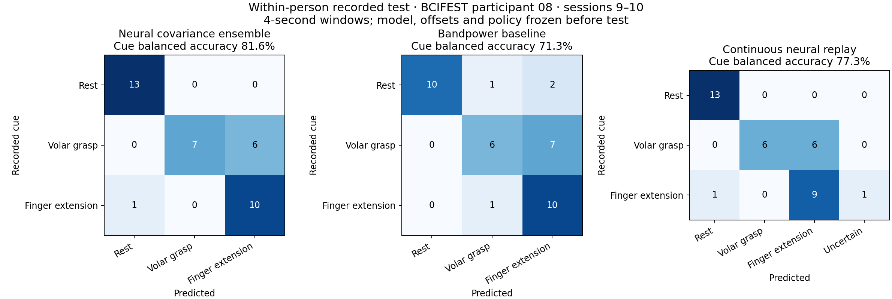

# Multiclass v2: the 70% cue-level target

The selected neural model achieved **81.59% balanced accuracy on 37 eligible held-out cue trials**. Continuous replay achieved **77.27% on 36 scored cues**, with 1 additional cue(s) unscored because too few clean sample-clocked windows were available. These point estimates exceed the requested 70% cue-level target. This is recorded within-person evidence; prospective personal validation is still needed.

| Held-out measure | Result |
|---|---:|
| Calibrated neural probabilities averaged per cue | 81.59% balanced accuracy |
| Continuous neural replay, confidence/margin gating | 77.27% cue balanced accuracy |
| Fixed bandpower baseline on the same eligible cues | 71.33% cue balanced accuracy |
| Individual neural windows | 63.92% balanced accuracy |
| Rest recall | 100.00% |
| Volar Grasp recall | 53.85% |
| Finger Extension recall | 90.91% |

The overall cue target is met; **70% on every class or every individual update is not met**. Volar Grasp remains the weak class. The neural cue score's exploratory run-cluster bootstrap 95% interval is 70.2%–92.3%; within-run permutation p=0.00033. Only two test sessions are available, so this interval is not a guarantee for another recording or wearer.

As a post-test reporting sensitivity check, assigning the 1 unscored replay cue(s) as incorrect to the most adverse class lowers the replay score to 74.89%. This check changes no model, offset or policy parameters. It still excludes the incomplete cues too short to contain the required window.

## What changed

The first raw-waveform EEGNet was replaced, in this separate multiclass engine, by a **train-referenced log-covariance feature model with three small neural networks averaged across fixed seeds**. Four frequency bands (8–12, 12–16, 16–22 and 22–30 Hz) preserve both power and inter-electrode relationships. Covariance shrinkage, channel scales, reference matrices and feature normalization use training data only. The 32-unit neural heads use dropout and weight decay; complete cue trials receive equal total sampling weight within each class.

This structure is motivated by spectral/spatial EEG decoding in [Schirrmeister et al.](https://pubmed.ncbi.nlm.nih.gov/28782865/) and covariance-based multiclass BCI in [Barachant et al.](https://hal.science/hal-00681328v1/document). This implementation uses a train-only arithmetic covariance reference followed by a matrix logarithm, with a neural head.

Eight declared candidates covered two neural feature families, all20 versus motor10 channels, and 2 versus 4-second windows. All three fixed seeds (13,42,73) were averaged; no best-seed selection occurred. Window candidates were compared on **the same 40 eligible tuning cues**, preventing a longer window from winning just by discarding different difficult cues.

Selected: **log_covariance_all20_4s**. Its uncalibrated tuning score was 76.19%. After observing development class imbalance, bounded class log-offsets were fitted only on tuning data, before the test: [0.0, 0.5, 0.0]. This increased the tuning score to 78.57%. Offsets and the replay policy were frozen before scoring the test; the calibration step was an adaptive development decision, not a pre-test performance result.

Replay selected EMA alpha 1.0, dwell 1 update(s), confidence 0.5 and margin 0.05 from tuning recordings. Alpha 1 means probabilities are unsmoothed. Four-second windows update every .25 seconds (93.75% overlap) and need four seconds before the first output.

Audit-PC decoder computation: median 0.98 ms, 95th percentile 1.26 ms across 225 outputs. This excludes acquisition/display latency and the four-second window accumulation.

## Data separation and coverage

Participant 08, BCIFEST task olrandmcmitrain: sessions **1–6 train**, **7–8 tune**, **9–10 test**. The earlier test sessions28–29 stayed exposed historical/development evidence. The selected v2 test signals were checked against the v1 signal hashes with no overlap. The two experiments use different cohorts and test sets; their percentages are not a paired estimate of the effect of changing the model.

The selected model retained 95 training cues, 40 tuning cues and 37 test cues. Test quality accounting: 44 selected-class cues before eligibility; 7 too short for the window/settling; 51 artifact windows and 0 flat windows rejected. The manifest keeps exact per-run exclusions. One empty event file (session10/run12), already identified in the inventory, was explicitly excluded before fitting; no labels were invented.

Replay accepted 97.6% of clean known-class updates and 94.7% of clean updates from the six untrained gestures. **This three-class model does not establish unknown-gesture rejection or nine-class control.** Reported accuracy excludes other gestures rather than calling them rest.



## Development comparison, before class-offset calibration

| Candidate | Common tuning cue balanced accuracy | Lowest class recall |
|---|---:|---:|
| filterbank_power_all20_2s | 66.27% | 7.14% |
| log_covariance_all20_2s | 73.41% | 28.57% |
| filterbank_power_motor10_2s | 66.67% | 7.14% |
| log_covariance_motor10_2s | 63.89% | 0.00% |
| filterbank_power_all20_4s | 66.67% | 7.14% |
| log_covariance_all20_4s | 76.19% | 28.57% |
| filterbank_power_motor10_4s | 61.90% | 0.00% |
| log_covariance_motor10_4s | 61.51% | 0.00% |

## Reproduce

```powershell
python improve_multiclass.py prepare --root "C:\path\to\BCIFEST\bids"
python improve_multiclass.py search
python calibrate_multiclass.py
python replay_multiclass.py --work session_reports/multiclass/sub08_three_class_v2/selected --root "C:\path\to\BCIFEST\bids"
python train_multiclass.py test --work session_reports/multiclass/sub08_three_class_v2/selected --root "C:\path\to\BCIFEST\bids"
python report_multiclass_improvement.py
```

The scored v2 experiment is now closed to tuning. Preserve its saved results; changing parameters requires unused future test data. Local raw windows, candidate weights and full manifests remain under ignored session_reports. Released reference weights are `decoder_and_models/multiclass_covariance_sub08_v2.pt` with an adjacent contract. The binary GUI's personal calibration flow is separate; prospective multiclass GUI calibration/receiver integration remains future work. Multiclass replay sends no actuator commands.
