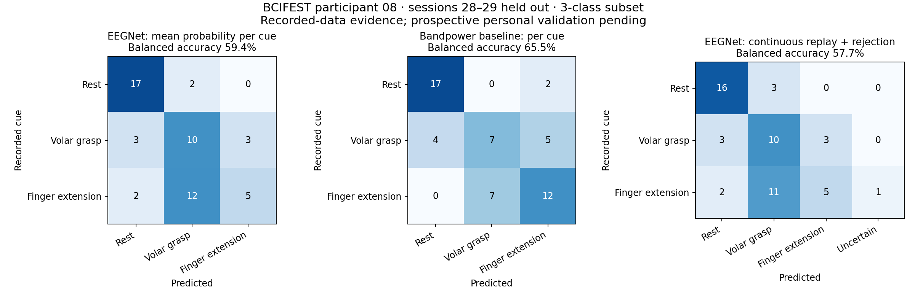

# First three-class experiment — November 3, 2026

Classes: **Rest / Volar Grasp / Finger Extension** from BCIFEST, participant 08.
Train sessions **21–25**, tune **26–27**, held-out test **28–29**. Split and class subset were fixed before fitting. This is within-person recorded-data evaluation; physical movement/EMG and the acquisition reference have not been independently verified.

| Method | Held-out cue balanced accuracy | Cue count |
|---|---:|---:|
| EEGNet, mean raw probability per cue | 59.43% | 54 |
| Fixed bandpower logistic baseline | 65.46% | 54 |
| EEGNet continuous replay, EMA/dwell/rejection | 57.68% | 54 |

Chance is 33.33%. Raw EEGNet window balanced accuracy is 53.44%; overlapping windows are not independent trials. Run-cluster bootstrap 95% interval for EEGNet cue balanced accuracy: 48.4%–70.1%. Within-run permutation p=0.00067. These quantify this small recorded test; only two independent test sessions are available.

## Quality and fitting

All 96 selected EDF/event pairs passed timing/annotation, rate, montage and duplicate-signal checks. Windows use volts, continuous causal 8–30 Hz filtering, 2-second duration, .25-second stride, .5-second settling, and at least four clean predictions per retained cue. Artifacts above 100 µV in the filtered signal and near-flat channels are rejected.

Training has 90 clean cues; tuning has 34; the raw-window test has 54. Each class/cue receives equal total sampling weight during NN fitting. Normalization uses training data only. Best epoch 21 was selected using tuning cue accuracy, with tuning loss breaking ties. No test-based model selection occurred.

Replay keeps filter/EMA history through every recorded cue, including the six untrained gesture types. Its inference windows align to the continuous sample clock, so eligible-window/cue counts can differ from onset-aligned training windows. Rejected outputs count as incorrect in balanced recall and have a separate confusion column. Policy parameters were selected on tuning sessions only and frozen before the test.

Replay accepted 88.3% of clean known-class updates. It also accepted 85.4% of clean updates from other protocol gestures. **A three-class softmax model is not a validated detector for unknown gestures.** The six other gestures were excluded from the three-class accuracy calculation, and their acceptance is reported separately rather than relabeled as rest.



## Reproduce

Released reference weights and baseline parameters: `decoder_and_models/eegnet_bcifest_sub08_three_class.pt` (with adjacent contract) and `decoder_and_models/bandpower_bcifest_sub08_three_class.json`.

Run each stage in order, with the studio Python environment:

```powershell
python train_multiclass.py prepare --root "C:\path\to\BCIFEST\bids"
python train_multiclass.py fit
python replay_multiclass.py --root "C:\path\to\BCIFEST\bids"
python train_multiclass.py test --root "C:\path\to\BCIFEST\bids"
python report_multiclass.py
```

Raw windows, per-run manifests, baseline parameters and trained artifacts initially remain in ignored `session_reports/multiclass/sub08_three_class_v1`. Hashes freeze model, contract, prepared arrays and provenance before testing. Test scoring is one-time per work folder; subsequent invocations read the saved report or fail rather than silently rerun training. A changed model requires a newly declared experiment and unused test data.

## What this enables next

The first NN shows above-chance recorded discrimination, but Finger Extension recall is only 26.3%, and the baseline has higher cue balanced accuracy on this test. This test is now exposed; do not use it to choose another NN architecture, seed, channel subset or threshold. Improve the approach using training/tuning data, then declare unused test data or new prospective recordings before claiming an improvement. Reliable three-class personal control and nine-way expansion are not established.

The multiclass model/trainer and replay engine work independently of the binary studio. The binary GUI still uses its own personal rest/action flow and rejects multiclass contracts. New-wearer multiclass acquisition, personal fitting, prospective GUI cues and gesture-aware receiver behavior require the next implementation/validation stage. Do not load these recorded-reference weights as a personalized model for a different wearer. No actuator output is enabled in multiclass replay.

Before expanding to nine classes, inspect this confusion matrix and establish fresh personal three-class performance. Binary rest/action accuracy cannot predict discrimination among fine-grained imagined gestures.
