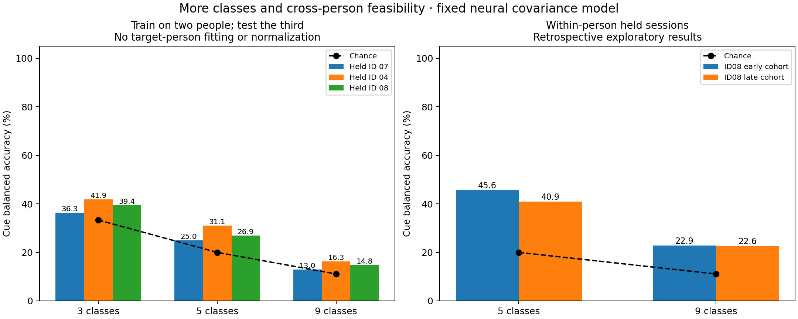
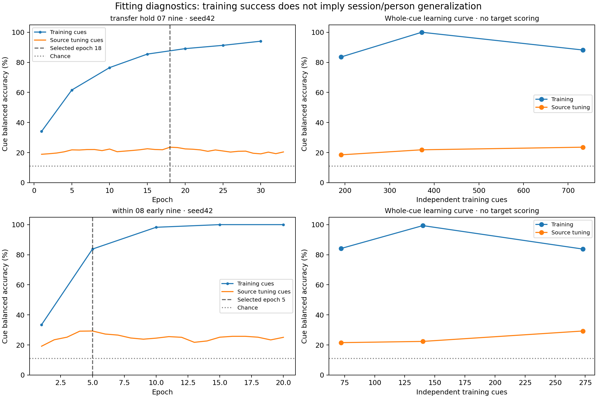
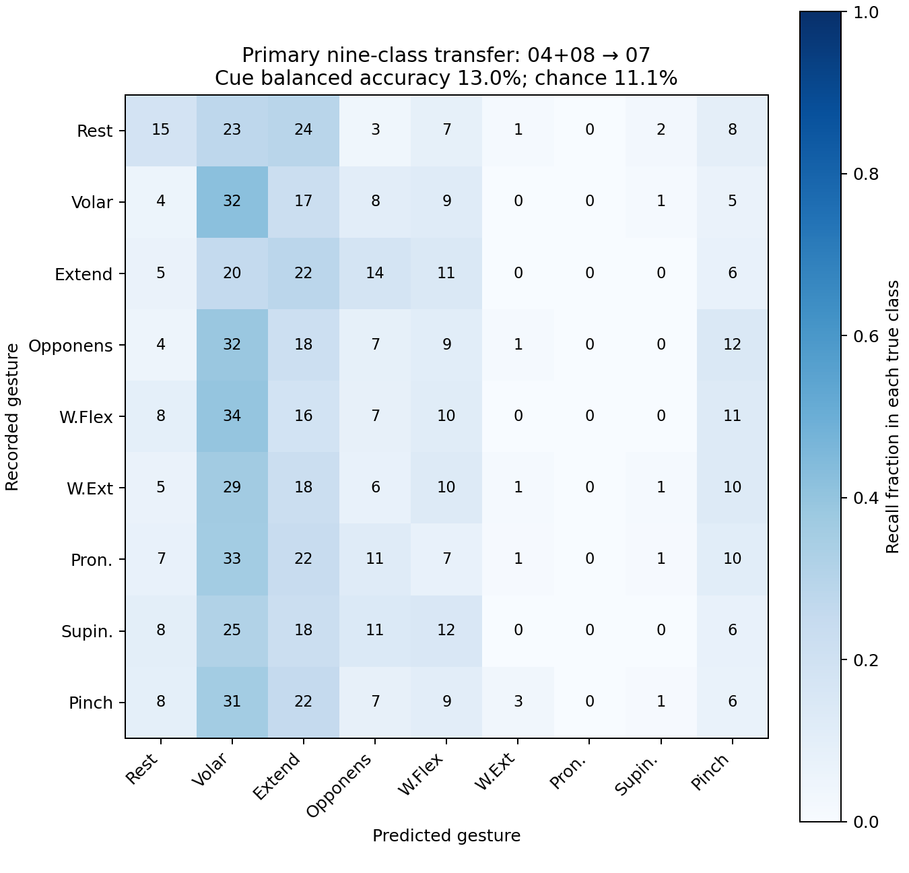

# More classes, cross-person training and fitting checks — November 3, 2026

The pipeline now trains **3, 5 and 9 output classes** and supports pooled-source training with a completely held-out dataset participant. Current results show limited transfer and large generalization gaps. They do **not** establish reliable five/nine-class or person-independent control. The separate three-class v2 recorded result (81.6% cue balanced accuracy) retains its original scope.

## Classes and the meaning of transfer

- **three** (3): Rest, Volar Grasp, Finger Extension
- **five** (5): Rest, Volar Grasp, Finger Extension, Wrist Flexion, Wrist Extension
- **nine** (9): Rest, Volar Grasp, Finger Extension, Opponens Grasp, Wrist Flexion, Wrist Extension, Wrist Pronation, Wrist Supination, Pinch Grasp

The model recognizes frequency-power and inter-electrode covariance patterns. It does not require identical raw waveform shapes across people. Here, cross-subject evaluation asks whether those gesture-related features transfer without using the target person's labels, normalization statistics, covariance reference, thresholds or early-stopping results. No target alignment or supervised target calibration is included in the zero-shot scores.

## Data repair and provenance

381 EDF recordings passed channel/rate, event and unique-signal checks across IDs04,07,08. **170 empty event tables were recoverable from native EDF annotations**. The recovered tables are separate private derivatives; source EDFs and TSVs remain unchanged. Recovery verifies known labels, positive durations and non-overlapping recorded intervals. Since native annotations are the recovered labels' source, they cannot independently corroborate themselves; physical display/acquisition timing is not externally measured here.

| Dataset ID | Included runs | Recovered event tables | Clean independent cues, all nine labels |
|---|---:|---:|---:|
| 04 | 50 | 30 | 280 |
| 07 | 140 | 140 | 745 |
| 08 | 191 | 0 | 1047 |

Fifteen ID04/session01 recordings used the EEGMI-style custom electrode layout rather than the common study montage. They were excluded before fitting. ID08/session10/run12 was excluded as a previously known empty event file. No electrode sites or gesture labels were invented to increase the dataset.

## Cross-person results

For each outer fold, two people supply training and source-only tuning sessions; the third person is absent from all fitting. The architecture and class sets are fixed. Primary new held ID07 was scored first; ID08 had informed earlier model design, so the remaining folds and the aggregate are exploratory, not a pristine population benchmark. Only three dataset participant IDs are available.

| Classes | Held ID | Neural cue balanced accuracy | Linear covariance baseline | Chance | Eligible cue trials |
|---|---|---:|---:|---:|---:|
| 9 | 07 | 13.0% | 11.8% | 11.1% | 745 |
| 5 | 07 | 25.0% | 20.5% | 20.0% | 403 |
| 3 | 07 | 36.3% | 33.0% | 33.3% | 237 |
| 9 | 04 | 16.3% | 14.8% | 11.1% | 280 |
| 5 | 04 | 31.1% | 24.5% | 20.0% | 153 |
| 3 | 04 | 41.9% | 39.2% | 33.3% | 94 |
| 9 | 08 | 14.8% | 13.2% | 11.1% | 1047 |
| 5 | 08 | 26.9% | 24.7% | 20.0% | 573 |
| 3 | 08 | 39.4% | 34.3% | 33.3% | 337 |

The primary nine-class result is **12.95%**, close to 11.11% chance. Small above-chance point estimates should not be treated as reliable gesture decoding. Per-run bootstrap intervals and within-run permutation results are in the aggregate JSON. These describe recordings within a held person, not uncertainty over the population of future wearers. No best subject or favorable class subset was selected after target scoring.



## Within-person more-class results

These use ID08's early or late session cohorts with whole-session partitions. Those recordings were already exposed in earlier development, so these are retrospective feasibility results. The fixed study uses 4-second windows, .5-second stride and a capped number of training draws per independent cue; it is not a paired replication of the tuned three-class v2 protocol.

| Case | Train cue BA | Tuning cue BA | Held-session cue BA | Linear baseline test BA |
|---|---:|---:|---:|---:|
| within_08_early_five | 100.0% | 51.6% | 45.6% | 47.9% |
| within_08_early_nine | 99.3% | 28.3% | 22.9% | 24.2% |
| within_08_late_five | 99.3% | 37.4% | 40.9% | 40.7% |
| within_08_late_nine | 100.0% | 20.7% | 22.6% | 23.9% |

Each task is scored only on its declared labels; untrained gestures are excluded rather than relabeled as Rest. These offline cue scores do not establish per-update accuracy, prospective calibration, artifact-free neural origin or live actuator behavior.

## Overfitting and underfitting

| Transfer case | Training cue BA | Source tuning cue BA | New-person cue BA |
|---|---:|---:|---:|
| transfer_hold_07_nine | 82.4% | 22.0% | 13.0% |
| transfer_hold_07_five | 91.7% | 35.0% | 25.0% |
| transfer_hold_07_three | 100.0% | 61.7% | 36.3% |
| transfer_hold_04_nine | 80.2% | 22.4% | 16.3% |
| transfer_hold_04_five | 98.4% | 42.6% | 31.1% |
| transfer_hold_04_three | 100.0% | 67.4% | 41.9% |
| transfer_hold_08_nine | 83.5% | 20.1% | 14.8% |
| transfer_hold_08_five | 88.3% | 33.6% | 26.9% |
| transfer_hold_08_three | 99.5% | 57.0% | 39.4% |

For the primary nine-class model, training reached **82.4%**, source tuning **22.0%**, and the held person **13.0%**. The large training/tuning gap is a strong warning about memorization/overfitting and session differences. The further held-person drop also reflects a person-domain transfer problem. The gap alone cannot identify how much each cause contributes.

Underfitting would be suggested by persistently poor training and tuning performance together, after checking optimization and data/labels. High training performance here shows that simply adding capacity is not an established solution. A poor held-person score by itself is not proof of underfitting.

Controls implemented: whole-person/session/cue separation; train-only feature statistics; equal weighting per person, class and cue; fixed three-seed averaging; early stopping using source tuning only; dropout, weight decay and covariance shrinkage; a lower-capacity linear baseline; matched inference-mode train/tuning losses; learning curves that add **independent cue trials**, not more overlapping copies. Large gaps remain despite these controls, so overfitting is **not claimed to be resolved**.

The displayed epoch/learning curves use seed42. Vertical markers show the selected checkpoints, which are restored after stopping; plotted later epochs do not replace those checkpoints. Ensemble metrics average all three selected members. Learning-curve fractions are 25%,50%,100% of whole source-training cues, with source tuning kept fixed and no held-person scoring. They are diagnostics and did not select a new target-tested algorithm. Optimization loss uses sampled windows and dropout; the separately recorded cue NLL/accuracy gives the matched inference-mode comparison.





## Next development decisions

Keep per-person calibration as the deployment goal. Obtain new independent recordings before making confirmatory improvement claims; every target in this study is now exposed. More independent people/sessions, reliable imagery compliance/timing/reference checks and class-specific confusion review are needed before expecting high accuracy on fine hand/wrist distinctions. Review source tuning data to reduce model complexity or improve regularization/features; reserve new target data for a final evaluation.

An additional transfer experiment could evaluate **label-free alignment using only an initial calibration prefix**, followed by later unseen recordings. It must be reported as adaptation separately from zero-shot transfer. [He and Wu's alignment paper](https://arxiv.org/abs/1808.05464) provides a relevant method; using an entire future test recording to fit alignment would change the evaluation assumptions. No alignment performance claim is made here.

The existing three-class personal goal remains separate from a universal model. Five/nine-class live GUI cues, per-person multiclass fitting and receiver mappings still require their own integration and prospective validation. The reference decoders support the class lists; no actuator transport is enabled in this study.

## Reproduce

```powershell
python study_multiclass_transfer.py prepare --root "C:\path\to\BCIFEST\bids"
python study_multiclass_transfer.py run
python report_multiclass_transfer.py
python -m pytest -q
```

Private recovered annotations, covariance caches, full manifests, fold weights and scored/frozen artifacts are under `session_reports/multiclass/cohort_study_v1`. The aggregate report and reference models can be versioned without publishing EEG or participant records. Existing scored cases are reused as saved evidence rather than silently retrained against their test results.
