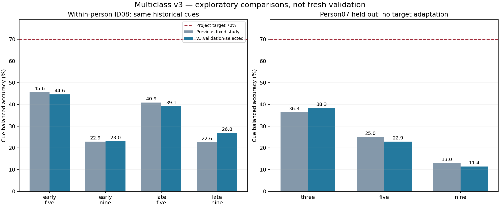
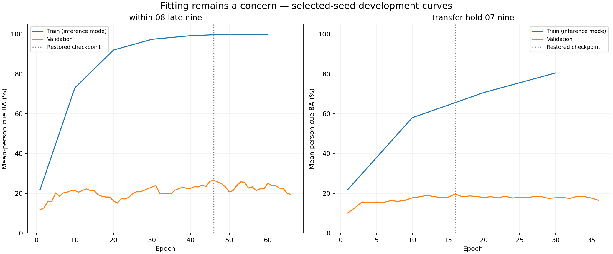

# Multiclass v3 development and separate binary lab release — November 3, 2026

**Binary lab software is unchanged.** All 36 protected files match commit `23baacb`. Use `Launch_BINARY_Lab.bat`, `verify_binary_release.py` and [Thursday November 5 checklist](THURSDAY_BINARY_VALIDATION.md). Its physical X24 connection and frozen new-cue self-test remain to be validated in the lab.

Multiclass work is isolated under `experiments/multiclass_v3/`; private weights and histories are in `session_reports/multiclass/development_v3` and `personal_v3`. There is no GUI/LSL/UDP entry point in this package. Binary templates, checkpoints, configs and the earlier three-class v2 model were not overwritten.

## What changed

Four feature sets × two neural heads were declared for each of 14 cases: 112 candidate fits plus two additional seeds for each selected ensemble. Candidates use motor-site power, relative spatial power, motor-site tangent covariance or all-site tangent covariance, with a linear neural head or a 16-unit network. Linear heads are lower-capacity controls. Independent-cue bag loss averages sampled-window probabilities before applying one loss per cue. Each epoch uses up to four windows per cue; whole people/sessions/cues remain separated. Dropout .5, weight decay .05, label smoothing .05 and covariance shrinkage .3 were tested. Selection and early stopping use source validation only; validation selection averages participant-level balanced accuracies. No new package dependency was added.

**Every historical test here was previously exposed.** All selected model/config/data hashes were frozen before each experiment set was scored, and no test outcome selected another candidate. These remain exploratory development comparisons, not fresh confirmation. Seed42 selects each feature/head; the fixed three-seed ensemble can have a different validation score. Re-running score reads the saved results; search refuses a finalized selection set.

## Same-person, same-session historical comparison

| ID08 cohort / classes | Previous cue BA | v3 cue BA | Difference, percentage points | Paired run-bootstrap 95% interval for difference |
|---|---:|---:|---:|---:|
| early / five | 45.6% | 44.6% | -1.0 | [-10.9, +9.5] |
| early / nine | 22.9% | 23.0% | +0.1 | [-5.4, +6.4] |
| late / five | 40.9% | 39.1% | -1.8 | [-12.5, +8.4] |
| late / nine | 22.6% | 26.8% | +4.2 | [-1.2, +9.6] |

Intervals resample the same recording runs for both frozen models and preserve identical cue trials. They do not describe uncertainty over future people or cap placements. A small point-score increase is not automatically a reliable improvement. Multiple methods changed together, so these comparisons cannot attribute a difference solely to cue-bag loss or regularization.

## Additional personal calibration feasibility

| Participant / classes | Train cue BA | Tuning cue BA | Later-session cue BA | Test cues | Selected feature / head |
|---|---:|---:|---:|---:|---|
| 04 / five | 57.0% | 32.1% | 28.0% | 62 | relative_motor / linear |
| 04 / nine | 30.9% | 20.7% | 17.9% | 114 | relative_motor / linear |
| 07 / five | 89.3% | 37.4% | 34.5% | 59 | tangent_all / linear |
| 07 / nine | 95.7% | 18.9% | 20.4% | 109 | tangent_all / linear |

ID04: session2 train,3 tune,4–5 test. ID07: sessions1–6 train,7–8 tune,9–10 test. These are different people/splits from ID08, so they are not paired improvements over it. All task classes must be present in each partition; other gestures are excluded from closed-set scoring rather than renamed Rest.

## Cross-person transfer and prefix adaptation

| Classes | Previous zero-shot, all ID07 sessions | v3 zero-shot, all ID07 sessions | v3 zero-shot, sessions3–10 only | Prefix-EA adaptation, sessions3–10 only |
|---|---:|---:|---:|---:|
| three | 36.3% | 38.3% | 39.7% | 35.2% |
| five | 25.0% | 22.9% | 24.0% | 23.3% |
| nine | 13.0% | 11.4% | 11.5% | 13.8% |

The two right columns use the same later-session cues. EA uses source-person training references and an unlabeled target prefix from sessions1–2. ALL accepted prefix gesture windows are included irrespective of the scored class subset; no target gesture labels fit the reference. Cue boundaries and signal-quality exclusions are available. Reference hashes are saved before predicting any later-session sample. The EA and non-EA arms select their own source-validation candidate, so this compares complete pipelines rather than isolating alignment alone. These results do not establish successful zero-shot or adapted control. Chance BA is 33.3%,20%,11.1% for 3/5/9 classes.

The method is motivated by [He and Wu’s Euclidean alignment paper](https://arxiv.org/abs/1808.05464). Published improvements are not assumed to transfer to these recordings; future target samples never fit our prefix reference.

## Overfitting, underfitting and limitations

| Case | Train cue BA | Source tuning cue BA | Historical target cue BA | Selected feature / head |
|---|---:|---:|---:|---|
| within_08_late_nine | 100.0% | 23.5% | 26.8% | tangent_all / small_nn |
| transfer_hold_07_three | 81.3% | 51.6% | 38.3% | tangent_motor / linear |
| transfer_hold_07_nine | 81.6% | 20.0% | 11.4% | tangent_all / small_nn |

Large train/tuning gaps remain for several models. Reducing a gap by lowering training accuracy does not by itself improve generalization. Some power-only candidates fit both training and tuning poorly, suggesting insufficient features/capacity, optimization limits or weak/variable task signal; this is not proof of a single cause. Low target accuracy alone does not diagnose underfitting. Inspect selected-epoch histories as well as both matched inference-mode losses; dropout training loss is a different quantity.

No five/nine-class case reaches 70%. The preserved three-class v2 result remains 81.6% cue BA on its specific historical within-person protocol, with 53.8% Volar Grasp recall and 63.9% individual-window BA; it does not certify this expanded task. Four-second windows, .5-second extraction stride and cue averaging here do not establish live per-update control. Physical imagery compliance, eye/muscle artifacts, reference and display/acquisition timing still need measurement; classifier accuracy alone does not prove a neural motor-imagery origin.

## Next steps

1. Complete Thursday’s unchanged binary calibration and two new frozen validation blocks. Save raw EEG, events, predictions, model/threshold and quality/exclusion counts.
2. For multiclass development, inspect source-training/tuning class confusions and recording quality. Keep all historical tests as exposed evidence; do not chase their scores by repeatedly selecting variants.
3. Plan a separate prospective 3→5-class session before attempting all nine. Use randomized independent cue blocks, measured event timing and a separate later validation block. More independent trials/sessions are required; no fixed trial count guarantees 70%. The personal multiclass GUI/receiver still requires implementation and prospective testing before that session.

## Reproduce and inspect

See [experimental package instructions](experiments/multiclass_v3/README.md). `audit/multiclass_v3_results.json` preserves all candidates/selected-seed histories and aggregate scores. Model bytes, source/prefix references and frozen artifacts remain private under `session_reports/multiclass/`. Original recordings/annotation files are unchanged. The binary integrity manifest checks files, not the installed environment or live hardware. Software tests are recorded separately in the release notes.
