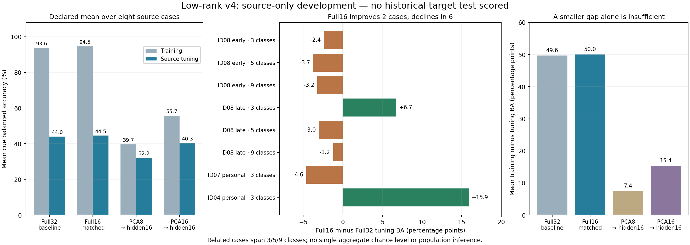

# Multiclass v4: source-only low-rank comparison — November 3, 2026

**Keep the current full32 lab architecture.** The smaller full16 candidate wins the declared source-selection rule by only **0.56 percentage points** on the eight-case mean, improving two cases and declining in six. That is insufficient evidence of a reliable improvement. The PCA candidates fit less of the training data but also perform worse on tuning data. No lab default, binary file or historical reference model was replaced.

## Scope and data separation

Four fixed candidates were fitted with three fixed seeds across eight declared source cases: **96 fits**. These are related task/domain cases from dataset IDs 04, 07 and 08, not eight independent people. Cases include three/five/nine classes on ID08’s early and late session cohorts, plus three-class personal cases on IDs 04 and 07.

The covariance guard indexed **12,374 declared training/tuning rows out of 24,500 cached rows**. The other 12,126 rows—including every historical target-test row—were not indexed. No target covariance reference, predictions, threshold selection or test accuracy was computed. Source code/config hashes were frozen before fitting. All source/tuning data had already been exposed in previous development; these scores select methods and do not establish fresh confirmation.

| Source case | Training sessions | Tuning sessions | Train / tuning independent cues |
|---|---|---|---:|
| ID08 early · 3 classes | 1, 2, 3, 4, 5, 6 | 7, 8 | 93 / 40 |
| ID08 early · 5 classes | 1, 2, 3, 4, 5, 6 | 7, 8 | 152 / 67 |
| ID08 early · 9 classes | 1, 2, 3, 4, 5, 6 | 7, 8 | 273 / 109 |
| ID08 late · 3 classes | 21, 22, 23, 24, 25 | 26, 27 | 87 / 30 |
| ID08 late · 5 classes | 21, 22, 23, 24, 25 | 26, 27 | 155 / 57 |
| ID08 late · 9 classes | 21, 22, 23, 24, 25 | 26, 27 | 294 / 113 |
| ID07 personal · 3 classes | 1, 2, 3, 4, 5, 6 | 7, 8 | 147 / 55 |
| ID04 personal · 3 classes | 2 | 3 | 31 / 24 |

## Methods and results

The baseline uses four-band log-covariance features from all 20 sites and a 32-unit neural head. The matched full16 model uses 16 hidden units, dropout 0.5 and weight decay 0.05. PCA8/PCA16 use the same 16-unit head and regularization, with PCA fitted only to class-balanced **whole training-cue mean features**, capped by independent-cue rank, and without whitening. The baseline has dropout 0.25 and weight decay 0.01. Comparisons with the baseline therefore change several controls; only the three 16-unit candidates match those controls.

Training lasts at most 80 epochs with source-only early stopping, three seeds 13/42/73, and at most four sampled windows per independent cue per epoch. Every overlapping copy of a cue stays in its partition. Training/tuning scores use inference mode and one mean probability vector per cue. The selection criterion is mean tuning cue balanced accuracy across all eight cases, then worst class recall, then lower mean cue NLL.

| Candidate | Mean training cue BA | Mean tuning cue BA | Train–tuning gap | Mean tuning cue NLL |
|---|---:|---:|---:|---:|
| full32_baseline | 93.63% | 43.98% | 49.65 pp | 1.415 |
| full16_matched | 94.54% | 44.54% | 50.00 pp | 1.377 |
| pca8_hidden16 | 39.66% | 32.22% | 7.44 pp | 1.466 |
| pca16_hidden16 | 55.70% | 40.33% | 15.37 pp | 1.420 |

This mean mixes tasks with different class counts. It has **no single chance baseline** and must not be described as accuracy of one universal model. Chance cue BA is 33.3%, 20%, 11.1% for a particular three/five/nine-class closed-set task, respectively.

| Source tuning case | Full32 | Full16 | PCA8 | PCA16 | Full16 difference |
|---|---:|---:|---:|---:|---:|
| ID08 early · 3 classes | 69.0% | 66.7% | 40.5% | 61.9% | -2.4 pp |
| ID08 early · 5 classes | 49.8% | 46.0% | 34.3% | 44.3% | -3.7 pp |
| ID08 early · 9 classes | 29.1% | 25.9% | 20.1% | 24.9% | -3.2 pp |
| ID08 late · 3 classes | 45.1% | 51.9% | 42.0% | 49.1% | +6.7 pp |
| ID08 late · 5 classes | 36.7% | 33.7% | 22.9% | 31.8% | -3.0 pp |
| ID08 late · 9 classes | 26.0% | 24.8% | 22.7% | 19.0% | -1.2 pp |
| ID07 personal · 3 classes | 62.8% | 58.2% | 42.0% | 58.4% | -4.6 pp |
| ID04 personal · 3 classes | 33.3% | 49.2% | 33.3% | 33.3% | +15.9 pp |

## Interpretation

The full32 and full16 models still have large training-to-tuning gaps. The full16 mean gain is driven by the late ID08 three-class case and the small ID04 three-class case; six other cases decline. Each candidate has zero recall for at least one class in at least one source case. There is no claim of 70% on every class or reliable five/nine-class decoding.

PCA8 lowers mean training BA to 39.7% and mean tuning BA to 32.2%. Its smaller 7.4-point gap is accompanied by substantially worse fitting and tuning. This is consistent with loss of useful feature information/underfitting, rather than evidence that overfitting was solved. PCA16 retains more information but also fails to improve the eight-case tuning mean. The scores alone cannot identify how much weak signal, recording differences or optimization contributes.

PCA can be folded algebraically into the first affine layer of the existing neural decoder. At inference, the maximum probability difference between explicit projection and the folded checkpoint was **3.58×10⁻⁷** across the source models; six focused tests verify folding, rank limits, whole-cue balance and the covariance-access guard. This establishes software equivalence, not improved EEG decoding.

The preserved [three-class v2 result](MULTICLASS_IMPROVEMENT_RESULTS.md), **81.6% historical cue BA**, belongs to its original within-person protocol and participant, with 77.3% continuous replay cue BA, 63.9% individual-window BA and 53.8% Volar Grasp recall. The source-only mixed-task scores here do not replace that result and do not predict performance on the new wearer. Its model and test artifacts remain unchanged.

## Evidence and next decision

- [Compact 32-case/candidate summary](audit/multiclass_v4_summary.json): training/tuning cue BA, per-class recalls, NLL, cue counts and access/folding evidence; no epoch histories.
- Full private models, three-seed histories and frozen declarations: `session_reports/multiclass/lowrank_v4_sourceonly/`; the complete aggregate is `study_results.json` there.
- Reproduce the declared source-only work with `python -m experiments.multiclass_v4.study`. A completed run reuses frozen evidence; modifying the declared code/config requires a separately versioned experiment, not deleting the old results.

Preserve the current lab default. Improvements to live data collection, cue timing, signal quality and independent personal validation can be assessed prospectively. Any future model candidate should be selected using source training/tuning and then evaluated on genuinely new recordings; no historical target was reopened in this study.
